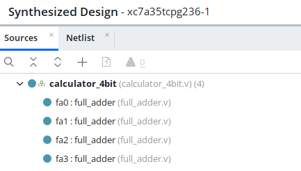
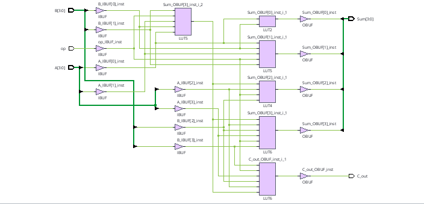
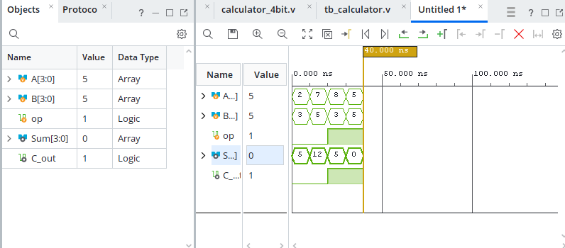

# 4-Bit Binary Adder/Subtractor Calculator

A 4-bit hardware calculator implemented in **structural Verilog HDL** using **AMD Xilinx Vivado**. The design builds up from a basic 1-bit logic block to a top-level unified Arithmetic Logic Unit (ALU) topology that handles both addition and subtraction dynamically using **2's Complement Arithmetic**.

---

## 🚀 Core Architecture Concept

To minimize transistor area (essential in VLSI design), this calculator reuses a single **4-Bit Ripple Carry Adder** to perform both operations, eliminating the need for an independent subtraction circuit.

- **Addition:** Computes A + B when control signal `op = 0`.
- **Subtraction:** Computes A - B when control signal `op = 1` by utilizing the 2's complement hardware trick:
  \[\text{Output} = A + \overline{B} + 1\]

### Controlled Inverter Trick
An array of XOR gates acts as a **smart switch** for the B input operands based on Boolean properties:
- `op = 0`: \(B \oplus 0 = B\) (Bits pass through unchanged).
- `op = 1`: \(B \oplus 1 = \overline{B}\) (Bits are inverted). Simultaneously, `op` passes a `1` directly into the first full adder's Carry-In (\(C_{in}\)), completing the +1 translation seamlessly.

---

## 📁 Hardware Design Hierarchy

The layout utilizes a structured **hierarchical VLSI design flow**:

```text
[Top Module: calculator_4bit]
      │
      ├─── 4x XOR Gates (Controlled Inverters)
      │
      └─── [Ripple Carry Adder Chain]
                 ├─── fa0 (Least Significant Bit Adder)
                 ├─── fa1 (Bit 1 Adder)
                 ├─── fa2 (Bit 2 Adder)
                 └─── fa3 (Most Significant Bit Adder)
```

*(📂 System Project Hierarchy)*  


---

## 🎛️ Synthesis Schematic Output

The Verilog code was successfully mapped and synthesized into gate primitives (`and`, `or`, `xor`) inside Vivado. Below is the structural layout showing the controlled inversion gates rippling carries column-by-column:

*(📂 Synthesized Hardware Circuit)*  


---

## 📈 Simulation & Functional Verification

A testbench script was written to simulate logic timelines down to picosecond resolution. Calculations verified on the waveform timeline include:
1. **Addition (`op = 0`):** 2 + 3 = 5
2. **Subtraction (`op = 1`):** 8 - 3 = 5

*(📂 Timing Waveform Analysis)*  


---

## 🛠️ Tools Used
- **HDL:** Verilog
- **IDE & Simulator:** AMD Xilinx Vivado
- **Target Platform:** Artix-7 FPGA (`xc7a35tcpg236-1`)
